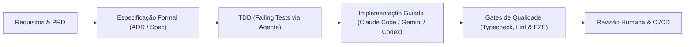

# Portfólio Técnico e Consolidação de Projetos para Currículo
## Engenharia de Software Aumentada por IA, Arquitetura de Sistemas & Computação Agêntica

> **Aviso de Confidencialidade (NDA-Compliant):** Em observância estrita às obrigações de confidencialidade contratuais, todos os nomes de clientes corporativos, empresas contratantes, marcas comerciais de terceiros, pessoas físicas (sócios, colaboradores e clientes) e credenciais foram omitidos ou descaracterizados. Todas as tecnologias de mercado, modelos de IA (Google Gemini, Claude Code, OpenAI Codex), arquiteturas de agentes autônomos (Hermes, Pydantic AI), ferramentas open-source, métricas técnicas e metodologias de engenharia são apresentadas com total precisão.

---

## 1. Resumo Executivo do Perfil Profissional

> **Engenheiro de Software & Arquiteto de Sistemas Orientados a IA (AI Systems Architect / Tech Lead)** com sólida vivência em arquitetura de microsserviços e monólitos modulares, governança de dados, automação de processos de missão crítica e desenvolvimento nativo com IA (*Agentic Engineering*).
> 
> Especialista na integração contínua de ferramentas autônomas de IA (**Claude Code, OpenAI Codex, Google Gemini, Pydantic AI**) ao fluxo de engenharia de software para aceleração extrema de entregas, com disciplina inegociável de **Test-Driven Development (TDD)**, arquiteturas orientadas a contratos (*Spec-First*) e blindagem de segurança (*sandboxing*, isolamento de ambientes e proteção de dados corporativos).
> 
> Histórico comprovado de liderança em reescritas arquiteturais críticas (Python/TypeScript), concepção de arquiteturas pioneiras de governança para agentes editores de código (**Hermes**), orquestração de frotas de agentes cognitivos especializados, integrações financeiras e governamentais de alta sensibilidade (APIs Bancárias Pix, Órgãos Fiscais Federais e Meta Graph API) e governança de implantação contínua (CI/CD hermético).

---

## 2. Matriz de Competências Técnicas & Keywords (ATS Friendly)

* **Linguagens & Runtimes:** TypeScript, JavaScript (Node.js 22/24 LTS), Python 3.12+ (uv, mypy strict, ruff, asyncio), SQL (PostgreSQL 16), Shell/Bash, PowerShell.
* **Frameworks & Bibliotecas:** Next.js 16 (App Router, Server Components, Server Actions), React 19, FastAPI, Pydantic AI, SQLAlchemy 2.0 (Async), Drizzle ORM, Tailwind CSS v4, shadcn/ui, Vitest, Playwright, Pytest, Pytest-asyncio, Express.js, Socket.io.
* **Engenharia de IA & Agentes Autônomos:**
  * **Modelos Cognitivos:** Google Gemini 3 Flash, Gemini 3 Pro Image Preview, Groq Whisper (`whisper-large-v3`), OpenAI Codex.
  * **Frameworks & Ferramentas Agênticas:** Pydantic AI (Structured Outputs, Tool Calling tipado), Claude Code CLI & SDK (`@anthropic-ai/claude-code`), Arquitetura de Agentes Autônomos de Código (**Hermes**).
  * **Metodologias de IA:** Avaliação Contínua de Agentes (*LLM Evals / Benchmarking*), Engenharia de Prompt Estruturado, *Prompt Chaining*, Orquestração Multi-Agente, Sandboxing, Throttle de Memória de LLMs e *Human-in-the-Loop*.
* **Bancos de Dados & Armazenamento:** PostgreSQL 16 (Modelagem Relacional, RLS, Particionamento de Workspace, Migrações Versionadas via Alembic e Drizzle Kit), SQLite, Redis/Jobstores transacionais.
* **Integrações & APIs de Terceiros:** API Bancária Pix (agendamento e liquidação de comissões, sagas de reconciliação financeira), APIs Governamentais de Dados Tributários (Receita Federal / e-CAC / Serpro), Provedor de Assinatura Eletrônica em Nuvem, Gateway Corporativo de Mensageria WhatsApp (Baileys), Meta Graph API (Instagram Publishing), Mercado Pago SDK.
* **Governança, Segurança & Infraestrutura:** Docker & Docker Compose, Caddy (Reverse Proxy com TLS automático), GitHub Actions (Pipelines de CI/CD, Gates de Proteção de Branches, Auto-merge), Políticas de Sandbox e Privilégio Mínimo, Mascaramento de PII / Conformidade LGPD (`structlog`), Redes Isoladas e Túneis SSH.
* **Metodologias:** Test-Driven Development (TDD), Domain-Driven Design (DDD), Clean Architecture, Specification-First (ADRs, PRDs executáveis), Code Reviews automatizados por agentes.

---

## 3. Realizações de Alto Impacto para o Currículo (Formato Google XYZ)

* **Arquitetura de Edição Autônoma Segura por IA (Hermes):** Projetou e implementou uma arquitetura pioneira de governança que viabilizou a edição de dashboards em tempo de execução por operadores não técnicos via agente conversacional de IA (**Hermes**), garantindo isolamento total por *sandboxing*, previews efêmeros com dados anonimizados e implantação automatizada em Staging via CI/CD, com **risco zero de vazamento de credenciais ou escrita no banco de dados corporativo**.
* **Reescrita Crítica de Plataforma Agêntica (Pydantic AI + Gemini):** Liderou a reconstrução completa do núcleo de uma plataforma de marketing autônomo conversacional via WhatsApp, migrando de um protótipo legado instável em TypeScript para uma arquitetura assíncrona robusta em Python 3.12+ com **Pydantic AI** e **Google Gemini 3 Flash**, alcançando **latência de resposta conversacional p95 < 12s** e cobrindo o sistema com mais de **100 suítes de testes orientados a especificações formais**.
* **Engenharia de Software Aumentada por IA & TDD:** Acelerou o ciclo de entrega de softwares complexos em múltiplos ecossistemas através do uso orquestrado de **Claude Code, Gemini e Codex**, mantendo **100% de cobertura nos caminhos críticos de negócio**, erradicando regressões em produção através de pipelines de integração contínua rigorosos e baterias de testes em Vitest, Playwright e Pytest.
* **SDK de Execução & Concorrência de Agentes (Claude Code):** Desenvolveu um wrapper programático em Node.js para o CLI do **Claude Code** com semáforos de concorrência, controle de estrangulamento de memória (prevenção contra OOM) e streaming em tempo real via WebSockets, sustentando a operação de uma frota de **10 agentes autônomos especializados** para extração de PDFs jurídicos e auditoria contábil.
* **Engenharia de Dados e Reconciliação Tributária/Financeira:** Estruturou um monólito modular de alta confiabilidade (Next.js 16 + Drizzle + PostgreSQL), reconciliando bases legadas heterogêneas com **mais de 5.200 empresas, 2.200 comissões e 1.500 faturas**, garantindo integridade matemática exata (sem inferência silenciosa de valores) e idempotência nas transações fiscais e bancárias.
* **Automação de Pagamentos e Sagas Financeiras:** Concebeu e implementou esteira de pagamentos de comissões integrada à API Pix bancária, incluindo máquina de estados durável com compensação automática, idempotência em comandos operacionais e tolerância a falhas em cenários de retorno bancário incerto.

---

## 4. Detalhamento dos Projetos

---

### Projeto 1: Plataforma Corporativa de Inteligência Fiscal & Operações Tributárias (LegalTech / Fintech)
**Domínio:** Gestão Comercial, Consultoria Tributária (ICMS/Federal), Cessões de Créditos e Liquidação Financeira  
**Papel:** Arquiteto de Software, Especialista em Integrações e Engenheiro Full-Stack

#### Contexto e Objetivo
Operação consultiva tributária e jurídica empresarial que realiza diagnósticos fiscais complexos, recuperação de créditos perante a Receita Federal (e-CAC/e-Processo), estruturação de contratos de cessão de direitos creditórios e cálculo de comissionamentos. O objetivo foi eliminar gargalos operacionais humanos, unificar fontes legadas divergentes (dois CRMs, planilhas e e-mails) e criar uma plataforma transacional auditável, rápida e integrada.

O ecossistema foi estruturado em dois grandes pilares técnicos:
1. **Core Web Monolith:** Aplicação corporativa de missão crítica voltada para as operações do dia a dia (Next.js 16 + Drizzle + PostgreSQL).
2. **Plataforma Agêntica Fiscal & CRM Headless:** Orquestração de agentes de IA, extensões de CRM, SDK de execução de LLMs e integrações externas.

#### Arquitetura Técnica & Stack
* **Frontend Corporativo:** Next.js 16.3.5 (App Router, React Server Components exclusivos, Server Actions), React 19, TypeScript strict, shadcn/ui, Tailwind CSS.
  * *Padrão Arquitetural:* Monólito modular organizado por *features*, com fronteiras estritas separando apresentação, controllers, procedures autorizadas no servidor, domínio e persistência.
  * *Regras de Ouro Implementadas:* **Zero `useEffect`** no código da aplicação (eliminando condições de corrida e efeitos colaterais de sincronização em tela); **teto físico de 400 linhas** por arquivo; sanitização e validação ponta a ponta com Zod.
* **Persistência & Isolamento:** PostgreSQL 16 com Drizzle ORM + Drizzle Kit. Drivers com pool limitado, garantia de concorrência e transações isoladas.
  * *Guarda de Isolamento:* O ambiente de testes e desenvolvimento opera sobre bancos descartáveis sintéticos (`pnpm db:prepare:isolated`), com bloqueio nativo em código contra qualquer conexão acidental direcionada a instâncias produtivas.
* **Camada Agêntica & SDK Próprio de LLMs:**
  * Implementação de wrapper em Node.js (`backend-sdk-claude`) que orquestra o `@anthropic-ai/claude-code` v2 via processos filhos gerenciados, incorporando controle de concorrência por semáforo e throttle de consumo de memória RAM do servidor para evitar quedas por Out-of-Memory (OOM).
  * Streaming bidirecional com o frontend via Socket.io e gerenciador de contexto de sessões em memória com expiração automática.
* **Frota Especializada de Agentes de IA:**
  * **`extrator-creditorio`:** Leitura automatizada e OCR estruturado de PDFs judiciais do e-CAC (PER/DCOMP, Despacho Decisório, Pareceres). Extração exata de valores, identificação da natureza jurídica do crédito (escritural própria vs. judicial vs. cessão de terceiro) e atribuição de flags de confiança com isolamento para revisão humana.
  * **Agentes Especialistas:** `auditor-calculos` (auditoria de cálculos fiscais), `auditor-jurisprudencia` (análise de precedentes), `validador-cessao-creditoria` (validação de contratos de cessão e habilitações), `extrator-folha` e `extrator-nfe`.
* **Integrações Externas:**
  * **API Pix Bancária:** Automação do agendamento, liquidação e conciliação bancária de comissões de parceiros.
  * **APIs Governamentais Fiscais (e-CAC / Serpro):** Obtenção programática de certidões e pendências fiscais federais.
  * **Provedor de Assinatura Eletrônica:** Criação e tracking de assinaturas digitais de instrumentos contratuais e cessões.
  * **CRM Headless Customizado:** Customizações nativas em Vite/React/TypeScript no frontend e extensões de banco de dados.

#### Desafios Técnicos Superados
1. **Reconciliação e Não-Degradação de Dados Legados:** A base de dados continha mais de 5.200 empresas e centenas de contratos em formatos legados não canônicos. Foi arquitetada uma migração progressiva com modelos de leitura compatíveis, sem forçar inferências silenciosas (ex.: nunca transformar dados fiscais ausentes em R$ 0,00).
2. **Confiabilidade Matemática Financeira:** Cálculos de comissão, balancete canônico e divisão entre cedentes/participantes projetados com precisão monetária determinística e travas transacionais contra mutações concorrentes.
3. **Governança Documental e Engenharia Orientada a Specs:** O projeto foi guiado por mais de 35 especificações técnicas formais, documentando desde o ciclo de vida do funil comercial até as regras de transição de status pós-contrato.

---

### Projeto 2: Plataforma WMS & Governança do Agente Editor Hermes (Indústria & Logística)
**Domínio:** Dashboards Operacionais, WMS (Armazenagem/Estoque) e Governança de Agentes Autônomos  
**Papel:** Arquiteto de Solução, Especialista em Governança de IA e Engenheiro DevOps

#### Contexto e Objetivo
Uma indústria e rede de comércio de grande porte demandava agilidade contínua na evolução de seus dashboards operacionais de WMS. A dependência de ciclos tradicionais de desenvolvimento atrasava a tomada de decisão. O desafio arquitetado foi: **Permitir que usuários e operadores de negócio solicitem alterações nos painéis diretamente a um agente de IA (Hermes) e publiquem em ambiente de Staging em minutos, com absoluta segurança e sem intervenção manual de TI**.

#### Arquitetura de Governança e Sandboxing Inovadora (Hermes)
Aprovada como diretriz canônica da empresa, a solução implementou uma esteira segura baseada em cinco pilares fundamentais:
```text
[Usuário via Chat] ➔ [Hermes em Sandbox Isolado] ➔ [Preview Efêmero + Diff Visual] 
   ➔ [Aprovação Humana] ➔ [Controlador Git/CI] ➔ [Auto-Deploy em Staging]
```
1. **Topologia de Repositórios Git Segregados:**
   * *Repositório Oficial (Produção):* Repositório canônico com artefatos imutáveis mantidos exclusivamente por engenheiros humanos. Acesso estritamente restrito.
   * *Repositório Sandbox (Staging):* Repositório experimental onde o agente autônomo **Hermes** opera. Recebe branches automáticas criadas pelo controlador, sem qualquer privilégio ou credencial de escrita para a base de produção.
2. **Contrato Operacional do Hermes (`.hermes/policy.json`):**
   * O agente opera em contêiner descartável (*ephemeral workspace*).
   * **Escopo de Arquivos Blindado:** O agente possui permissão de escrita exclusivamente em templates de visualização específicos (`dash4.template.html`) e testes unitários locais (`app/test/hermes-changes/**`). Qualquer tentativa de acessar arquivos de infraestrutura, Docker, CI, chaves de autenticação ou código-fonte do core é bloqueada imediatamente pelo validador de políticas.
3. **Preview Efêmero e Inspeção de Diff:**
   * O **Hermes** gera uma instância local temporária em porta aleatória vinculada estritamente a `127.0.0.1`, com tempo de vida de 15 minutos, utilizando *fixtures* anônimas.
   * O usuário final inspeciona o resultado visualmente e valida o diff de código antes de qualquer submissão.
4. **Daemon Controlador & CI/CD Hermético:**
   * O agente de IA **não possui comando de Git commit, push ou SSH**. Ele entrega o workspace congelado para um serviço controlador.
   * O controlador roda a suíte de testes (`npm test`), gera branch, submete Pull Request no GitHub e, mediante aprovação do GitHub Actions (`ci.yml`), realiza o auto-merge e deploy em Staging.
   * A promoção para Produção permanece isolada por um *air-gap* humano.
5. **Painel de Monitoramento da Frota Hermes (`agentes-dashboard`):**
   * Aplicação em Python 3.12 / FastAPI para governança das instâncias ativas do Hermes e demais agentes na VPS, integrando controle de linhas corporativas de mensageria, reverse proxy Caddy, allowlists de remetentes e autenticação via cookies criptografados com papéis salvos em PostgreSQL.

#### Desafios Técnicos Superados
* **Mitigação de Riscos de Agentes Autônomos:** Neutralização completa de injeções de prompt ou desvios de conduta da IA via barreiras de sistema operacional, permissões de arquivo em modo leitura e ausência de ferramentas de mutação no banco de produção.
* **Garantia de Uptime e Resiliência de Deploy:** Eliminação de regressões acidentais em produção através de controle de tags datadas no Docker, impedindo substituição de artefatos estáveis por imagens locais não homologadas.

---

### Projeto 3: Plataforma de Marketing Conversacional Autônoma via WhatsApp (Startup AI-Native)
**Domínio:** Agência de Marketing Digital Conversacional Autônoma via WhatsApp  
**Papel:** Engenheiro de Software Core & Arquiteto de Sistemas de IA

#### Contexto e Objetivo
Plataforma inovadora que atua como uma agência de marketing completa e automatizada para empresas e criadores de conteúdo, operando inteiramente através de diálogos estruturados no WhatsApp. O cliente assume a posição de Diretor Criativo e Aprovador, enquanto o sistema de IA gerencia o planejamento editorial, a geração de cópias/roteiros, o design visual de posts e carrosséis, o aprendizado comportamental da voz da marca e a publicação final nas redes sociais.

O projeto representou a reescrita técnica de um protótipo legado instável em TypeScript para uma stack proprietária moderna em Python, focada em alto desempenho e controle estrito turno a turno.

#### Arquitetura Técnica & Stack
* **Linguagem & Framework Agêntico:** Python 3.12+ utilizando **Pydantic AI** e FastAPI. A escolha de Pydantic AI garantiu validação estrita de esquemas em tempo de execução para cada *tool call*, eliminando saídas mal formatadas.
* **Modelos Cognitivos & Multimodalidade:**
  * **Google Gemini 3 Flash:** Raciocínio conversacional, condução do fluxo de onboarding e geração de estratégias com latência ultrabaixa e custo marginal.
  * **Google Gemini 3 Pro Image Preview:** Geração e composição de layouts visuais, eliminando o problema crônico de textos deformados (*gibberish*) em português.
  * **Groq Whisper (`whisper-large-v3`):** Transcrição de áudios de clientes enviados via WhatsApp com latência inferior a 1 segundo.
* **Mensageria & Jobs:** Gateway corporativo de WhatsApp Baileys-as-a-service; APScheduler integrado diretamente ao PostgreSQL (eliminando complexidade desnecessária de instâncias Redis).
* **Persistência & Rastreabilidade:** PostgreSQL 16 com SQLAlchemy 2.0 assíncrono e migrações versionadas via Alembic (22+ tabelas relacionais). Isolamento multitenant estrito por conta de cliente.
* **Observabilidade & LGPD:** Logging estruturado em JSON com `structlog`, com sanitização automática de dados pessoais sensíveis (PII Masking).
* **Tooling Moderno em Rust:** Gerenciamento de dependências ultrarrápido com `uv` (Astral), linters com `ruff` e checagem estática com `mypy --strict`.

#### Engenharia com Mais de 100 Especificações & Baterias de Testes
O projeto se destaca pelo volume e rigor de sua cobertura de testes unitários, de integração e sistemas de avaliação contínua (*Evals*):
* **Suíte Spec-Driven:** Implementação de mais de 100 suítes de testes orientadas a especificações técnicas numeradas (`test_spec07` a `test_spec105`):
  * Contratos de esqueletos visuais, copyfit de contornos e fronteiras de renderização.
  * Ativação, adaptadores e histórico de grupos de concierge multiusuário no WhatsApp.
  * Automação da publicação multiformato (feed e stories) via Meta Graph API do Instagram.
  * Menus interativos no WhatsApp com botões de seleção de paleta cromática e arquétipos de marca.
  * Módulo de aprendizado comportamental contínuo (*Behavioral Learning*), que detecta padrões de rejeição do cliente e sintetiza regras editoriais automáticas para os próximos posts.
* **Harness de Avaliação Contínua (`tests/evals`):** Avaliação quantitativa de qualidade de prompts e fidelidade de saídas em relação a rubricas pré-definidas (sem depender de validação manual para saber se o agente regrediu em tom de voz ou alinhamento visual).

---

## 5. O Diferencial Metodológico: Engenharia Aumentada por IA

O desenvolvimento de todos os projetos acima não utilizou ferramentas de IA como mero "auto-completar de código", mas sim como **agentes e colaboradores autônomos em um ciclo de engenharia rigoroso**:



1. **Abordagem *Spec-First* (Especificação Executável):** Antes de gerar código, definiam-se contratos claros (esquemas Zod/Pydantic, dicionários de domínio e fluxos de exceção). Agentes como **Claude Code** eram instruídos a ler a especificação e gerar os testes unitários de falha primeiro (fase Vermelha do TDD).
2. **Mitigação Sistemática de Erros & Alucinações:**
   * Utilização de tipos estritos (`strict` no TypeScript e `mypy --strict` no Python com Pydantic), impedindo que respostas não determinísticas das IAs quebrassem as camadas de persistência.
   * Criação de *guards* locais de banco de dados e testes de integridade que falham fechados caso qualquer variável de ambiente aponte para um alvo inadequado.
3. **Aceleração com Sustentabilidade:**
   * Redução de semanas para dias em tarefas de alta repetição (migrações de esquemas complexos, escrita de centenas de casos de teste de regressão e documentação técnica viva).
   * Arquiteturas limpas mantidas intencionalmente simples (*KISS / Monólitos Modulares*), evitando complexidade prematura de microsserviços onde um monólito modular bem tipado entrega maior velocidade e confiabilidade.

---

## 6. Preparação para Entrevistas Técnicas (Casos em Formato STAR)

### Case 1: Governança e Sandboxing de Agentes Autônomos de Código (Hermes / Indústria & Logística)
* **Situação (Situation):** Operadores de negócio precisavam alterar painéis gerenciais constantemente. A equipe de TI era um gargalo, mas dar acesso direto ao código ou permitir que uma IA alterasse arquivos de produção e bancos corporativos gerava riscos inaceitáveis de segurança e downtime.
* **Tarefa (Task):** Conceber uma arquitetura que permitisse a edição conversacional de código por um agente de IA (**Hermes**) com publicação em Staging sem expor a infraestrutura e sem riscos para produção.
* **Ação (Action):** Idealizei e formalizei a proposta arquitetural de dois repositórios segregados (Produção Oficial vs Staging Experimental). Desenvolvi o contrato operacional de sandboxing do agente Hermes (`.hermes/policy.json`), limitando as permissões de escrita a templates isolados e testes, com geração de preview efêmero na máquina local e exigência de aprovação humana de diff antes que um daemon controlador executasse o fluxo de PR e CI/CD.
* **Resultado (Result):** Operadores passaram a ter suas solicitações de painel atendidas em minutos em Staging, com total blindagem dos segredos da VPS, zero acessos diretos ao banco e risco nulo de quebras em produção.

### Case 2: Reescrita e Estabilidade de Plataforma de IA Conversacional (Pydantic AI + Gemini / Startup AI-Native)
* **Situação (Situation):** A plataforma de marketing conversacional no WhatsApp sofria com instabilidades, lentidão e respostas malformadas geradas por um framework experimental legado em TypeScript.
* **Tarefa (Task):** Reestruturar a aplicação do zero, garantindo controle estrito de diálogo turno a turno, isolamento multitenant, resposta rápida e fidelidade visual aos clientes.
* **Ação (Action):** Migrei a arquitetura para Python 3.12 assíncrono com **Pydantic AI** e modelos **Google Gemini 3**. Desenvolvi uma suíte de testes com mais de 100 especificações técnicas formais e um ambiente de Evals contínuos. Implementei geração visual por camadas, isolando texto em português com Gemini 3 Pro Image Preview e integrando transcrição rápida com Groq Whisper.
* **Resultado (Result):** Alcançou-se estabilidade operacional contínua, resposta no WhatsApp com latência p95 < 12 segundos, proteção rigorosa contra vazamento de dados de clientes (LGPD) e capacidade de atender múltiplos clientes em concierges de grupo.

### Case 3: Integridade Transacional e Reconciliação Tributária (Claude Code SDK / LegalTech & Fintech)
* **Situação (Situation):** A operação tributária lidava com milhares de registros de crédito e comissões espalhados entre múltiplos CRMs, planilhas e e-mails, com frequentes divergências de valores e falta de rastreabilidade jurídica.
* **Tarefa (Task):** Desenvolver um sistema central unificado, com 26 superfícies operacionais, capaz de ler bases legadas sem adulterar o histórico e automatizar o cálculo e pagamento de comissões via Pix.
* **Ação (Action):** Arquitetei o monólito modular em Next.js 16 + Drizzle + PostgreSQL com isolamento estrito de transações e procedimentos autorizados no servidor. Modelei sagas determinísticas de compensação financeira integradas à API Pix bancária e construí um SDK próprio para orquestrar **Claude Code** em processos isolados com semáforo e throttle de memória, sustentando a extração automatizada de cópias integrais de processos tributários da Receita Federal.
* **Resultado (Result):** Unificação de mais de 5.200 empresas cadastradas sob um modelo de dados canônico, redução drástica do tempo de triagem de processos judiciais e auditoria completa de ponta a ponta em todos os pagamentos realizados.
